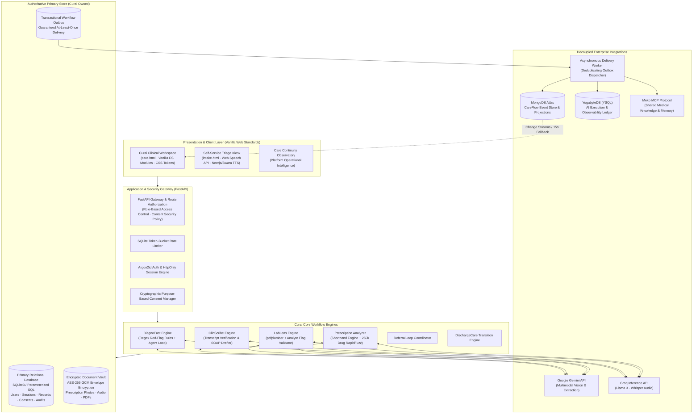
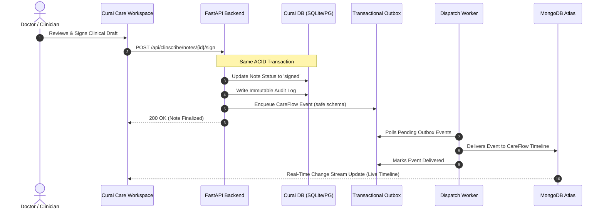
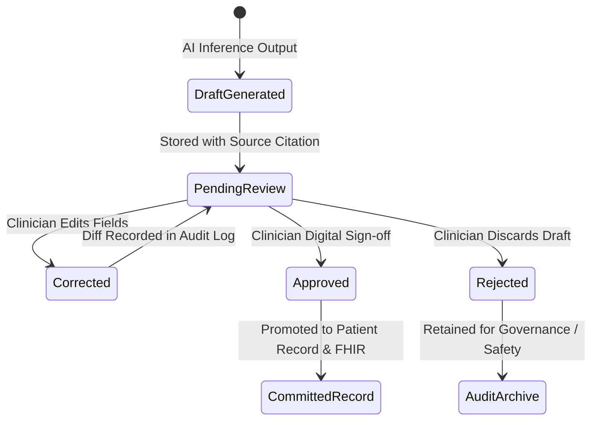

<div align="center">

# 🩺 Curai
### *Connected, Organised and Intelligent Healthcare Workflow Platform*

**An AI-assisted, human-governed clinical operating system uniting patient intake, ambient documentation, diagnostic intelligence, prescription guidance, and care transitions onto ONE shared longitudinal patient record.**

*Formerly Diagnosia · Built for High-Volume, Time-Constrained Clinical Environments*

[](LICENSE)
[](https://www.python.org/)
[](https://fastapi.tiangolo.com/)
[](#-the-six-clinical-tools)
[](#-safety-boundaries--clinical-governance)
[](docs/FHIR_MAPPING.md)

[Overview](#-overview) • [The Clinical Crisis](#-the-clinical-crisis-in-high-volume-care) • [The Six Tools](#-the-six-clinical-tools) • [Architecture](#-system-architecture) • [Integrations](#-enterprise-integrations) • [CareFlow](#-careflow-the-live-patient-journey) • [Safety & Governance](#-safety-boundaries--clinical-governance) • [Getting Started](#-getting-started) • [Tech Stack](#-technology-stack)

</div>

---

> [!CAUTION]
> **DEVELOPMENT PROTOTYPE & SYNTHETIC DATA PILOT ONLY — NOT FOR REAL-PATIENT CARE.**
> Curai is currently in a synthetic pilot stage. It must be operated using synthetic/de-identified demo profiles only. Curai does not provide automated diagnoses, does not prescribe, does not alter medication dosages, and does not replace the clinical judgment of qualified healthcare professionals. All AI outputs are strictly non-authoritative reviewable drafts.

---

## 💡 Overview

In public healthcare systems and busy outpatient departments (OPDs) across India and emerging economies, a physician often consults with **60 to 100+ patients in a single morning**, spending **under two to three minutes per consultation**. In that brief window, doctors are forced to elicit history from scratch, transcribe physical documents, decode illegible handwriting, piece together fragmented diagnostic reports, and manage manual referrals.

**Curai** solves clinical fragmentation by providing an integrated, **visit-aligned care platform**. From pre-consultation voice intake in the waiting room to post-discharge care coordination at home, Curai maintains **One Single Source of Truth**—a unified longitudinal patient record backed by cryptographic consent, tamper-evident audit logs, real-time workflow event streaming, and strict human-in-the-loop validation.

```
   BEFORE THE VISIT                DURING THE VISIT                       AFTER THE VISIT
┌──────────────────────┐   ┌───────────────────────────────┐   ┌───────────────────────────────────┐
│     DiagnoFast       │   │  ClinScribe     LabLens       │   │ Prescription   ReferralLoop       │
│  Voice-first intake  │──▶│  Ambient notes  Diagnostic    │──▶│ Analyzer       Closed-loop consults│
│  Waiting-room kiosk  │   │  & SOAP drafts  digitization  │   │ Multilingual   DischargeCare       │
│  1-page requisition  │   │  Doctor signs   Analyte trends│   │ Rx explanation Transition checklists│
└──────────┬───────────┘   └───────────────┬───────────────┘   └─────────────────┬─────────────────┘
           │                               │                                     │
           └───────────────────────────────┼─────────────────────────────────────┘
                                           ▼
                 ┌───────────────────────────────────────────────────┐
                 │          ONE SHARED LONGITUDINAL RECORD           │
                 │   History · Encounters · Lab Results · Medicines  │
                 │   Referral Milestones · Transition Tasks · Audit  │
                 └───────────────────────────────────────────────────┘
```

---

## 🚨 The Clinical Crisis in High-Volume Care

1. **Information Asymmetry & Repetitive History Gathering**: Vital consultation seconds are consumed repeating elementary questions (*"Since when? Any fever? What medicines do you take?"*) while past medical history remains locked in lost papers.
2. **Clinical Scribing Burden**: Doctors spend more time looking at computer screens and clipboards writing notes than looking at their patients, driving severe clinician burnout.
3. **Unstructured & Scanned Diagnostic Reports**: Laboratory results are delivered as isolated paper printouts or scanned photos on messaging apps. Values cannot be automatically graphed or correlated longitudinally.
4. **Dangerous Prescription Ambiguity**: Illegible handwriting and Latin shorthand (`1-0-1`, `OD`, `TDS`, `AC`, `HS`, `SOS`) confuse patients, leading to dangerous under-dosing, missed antibiotic regimens, or adverse drug events.
5. **The "Silent Referral Drop"**: Over 30% of outpatient specialist referrals are never fulfilled because there is no closed-loop tracking mechanism between referring physicians and specialists.
6. **Discharge Coordination Void**: Patients leave hospitals with unstructured discharge papers, uncertain when to resume home medications, and without traceable follow-up schedules.

---

## 🛠️ The Six Clinical Tools

Curai organizes its capabilities directly around the natural cadence of a patient encounter: **Before**, **During**, and **After** the visit.

| Phase | Tool | Target User | Core Capability | Safety Mechanism |
|---|---|---|---|---|
| **Before Visit** | **DiagnoFast** | Patients, Triage Nurses, Reception | Voice-driven multilingual waiting-room intake with automated 1-page clinician requisition | Two-layer deterministic red-flag emergency screening (regex rules + AI fallback) |
| **During Visit** | **ClinScribe** | Clinicians, Scribes | Ambient consultation transcription into structured SOAP / H&P clinical notes | Strict quotation verifier against transcript; doctor review & digital sign-off gate |
| **During Visit** | **LabLens** | Pathologists, Doctors, Patients | Dual-engine lab report parser (local PDF + vision OCR) with longitudinal analyte trending | Uncertainty scoring; conflicting range detection; manual compare gate before committing |
| **After Visit** | **Prescription Analyzer** | Patients, Caregivers, Pharmacists | Vision OCR, shorthand decoder, and 250k drug registry validation in Hindi/English | Mandatory patient confirmation tick-gate; unconfirmed medicines routed to pharmacist |
| **After Visit** | **ReferralLoop** | General Physicians, Specialists | End-to-end closed-loop specialist referral, routing, and back-consultation tracker | Eliminates silent drops; SLA tracking; bi-directional clinical note handoff |
| **After Visit** | **DischargeCare** | Inpatient Teams, Family Caregivers | Discharge transition organizer, caregiver task checklist, and follow-up protocol | Transition gate requires all pending tasks/results cleared or documented exception |

---

### 1. DiagnoFast — Voice-First Conversational Patient Intake

DiagnoFast captures the patient's medical history while they sit in the waiting room, transforming spoken answers into a structured, concise, one-page clinical brief before the patient steps into the doctor's cabin.

* **Multilingual Spoken Interaction**: Powered by Indian English (`Neerja`) and Hindi (`Swara`) neural voices via Microsoft Edge TTS, with secondary fallbacks to Groq WAV and native browser speech synthesis.
* **Dual Access Modalities**:
  * **Reception-Generated One-Time Links**: Single-use cryptographic tokens sent to the patient's smartphone, auto-expiring in 2 hours or after interview completion.
  * **Self-Service Waiting Room Kiosk**: Configured via `DIAGNOFAST_KIOSK_DOCTOR_ID` on a shared tablet; routes patients straight into the selected doctor's queue without requiring accounts.
* **Six Specialty-Specific Clinical Protocols**: General Medicine, Dermatology, Cardiology, Orthopaedics, ENT, and Paediatrics.
* **Deterministic Two-Layer Red-Flag Screening**:
  1. *Layer 1 (Code-based regex rules)*: Evaluates answers in English, Hindi, and Hinglish for emergency indicators (chest pain, stroke symptoms, acute dyspnoea, severe haemorrhage, anaphylaxis, self-harm). Bypasses AI entirely, halts the interview immediately, and instructs the patient to seek immediate reception assistance.
  2. *Layer 2 (AI contextual check)*: Screens subtle contextual presentations while filtering historical mentions ("my father had a stroke 5 years ago").
* **Staff Emergency Alert Banner**: Real-time polling (`GET /api/diagnofast/alerts`) broadcasts high-priority emergency alerts directly across all active doctor and reception workstations.
* **One-Page Physician Requisition**: Formats chief complaints, history of present illness (HPI), reported review of systems (ROS), allergy history, and expandable original audio/transcripts for rapid clinical review.

---

### 2. ClinScribe — Ambient Consultation Documentation & Scribe

ClinScribe eliminates clinical documentation overhead by capturing the ambient doctor-patient dialogue (with explicit consent) and generating structured, reviewable clinical notes.

* **Flexible Clinical Templates**: Automatically structures notes into standardized SOAP (Subjective, Objective, Assessment, Plan) or formal History & Physical (H&P) structures.
* **Strict Hallucination Verification**: Every drafted clinical assertion is mapped against verbatim transcript segments (`evidence_turns`). Unsubstantiated claims are flagged for doctor inspection.
* **Physician Sign-Off Workflow**: Notes remain in an immutable `DraftGenerated` / `PendingReview` state until the attending physician edits and applies a cryptographic digital sign-off (`reviewed_by`, `reviewed_at`).
* **Privacy-Preserving Audio Life-Cycle**: Once the final note is signed, consultation audio and transcripts are automatically purged by default unless explicit patient research/record retention consent is granted.
* **FHIR R4 Composition Export**: Generates compliant FHIR R4 clinical documentation bundles ready for national health exchange interoperability.

---

### 3. LabLens — Diagnostic Report Digitization & Longitudinal Tracking

LabLens unlocks trapped laboratory data from paper printouts, text PDFs, and smartphone photos into normalized clinical observations.

* **Hybrid Dual-Engine Extraction**:
  * *Local Deterministic Engine*: Employs `pdfplumber` and rule-based regex parsers on Curai's server for instant, zero-cost, private text-based PDF parsing.
  * *Multimodal Vision Engine*: Routes scanned or photographed lab reports to Google Gemini and Groq vision models when programmatic text extraction is unavailable.
* **Biological Range & Plausibility Validation**: Detects contradictory printed flags (e.g., a value marked "High" despite falling within the stated reference interval), flags missing units, and highlights implausible physiological values.
* **Human-in-the-Loop Observation Gate**: Parsed analytes are presented in a side-by-side reconciliation viewer. Clinicians or pathologists confirm or adjust values before they commit to the official patient record.
* **Longitudinal Analyte Graphing**: Correlates repeated tests over time (HbA1c, Serum Creatinine, Platelet counts, Lipid profiles) to reveal therapeutic trajectories.

---

### 4. Prescription Analyzer — Patient Medication Comprehension

The Prescription Analyzer bridges the dangerous comprehension gap between handwritten doctor prescriptions and the patient's daily routine at home.

* **Multi-Page Multimodal Vision Reader**: Ingests up to 4 photos per prescription (front, back, follow-up notes) using Google Gemini and Groq vision pipelines.
* **Zero-Guessing Confidence Engine**: Automatically categorizes extracted medication fields as `clear`, `unsure`, or `unreadable`. The model is strictly instructed never to guess illegible text.
* **Deterministic Latin Shorthand Parser**: Pure deterministic code rules (independent of LLM hallucinations) decode clinical instructions:
  * Frequency codes: `OD` (once daily), `BD` (twice daily), `TDS` (thrice daily), `QID` (four times daily), `HS` (at bedtime), `SOS/PRN` (as needed).
  * Timing notations: `AC` (before meals), `PC` (after meals), `BBF` (before breakfast).
  * Dose matrices: `1-0-1`, `1-0-0`, `0-0-1`, `1/2-0-1/2`.
* **250,000+ Indian Medicine Registry Cross-Check**: Performs fuzzy string matching (`rapidfuzz`) against a comprehensive database of Indian pharmaceutical brand names and generic compositions. Any "clear" name not found in the verified registry is automatically demoted to `unsure`.
* **Mandatory Patient Tick-Gate**: Patients must review and explicitly tick each medication matching their physical prescription slip. Any unconfirmed or unreadable drug is **quarantined from AI explanation** and routed to a prominent "Ask Your Pharmacist" checklist.
* **Holistic Multilingual Guidance**: Explains confirmed medications in plain Hindi or English with neural voice playback, structured morning/afternoon/night scheduling charts, dietary instructions, and lifestyle guidance. Never alters dosage or suggests drug substitutions.

---

### 5. ReferralLoop — Closed-Loop Specialist Coordination

ReferralLoop prevents patients from falling through the cracks of fragmented healthcare ecosystems by tracking cross-specialty referrals from initiation to consultation return.

* **Full-Lifecycle Referral State Machine**:
  $$\text{Drafted} \longrightarrow \text{Dispatched} \longrightarrow \text{Acknowledged} \longrightarrow \text{Booked} \longrightarrow \text{Attended} \longrightarrow \text{Outcome Returned} \longrightarrow \text{Review Closed}$$
* **Context Preservation**: Seamlessly attaches relevant clinical notes from ClinScribe, baseline lab trends from LabLens, and intake history from DiagnoFast to the referral packet.
* **Aging & Bottleneck Monitoring**: Identifies stalled referrals where patients have not booked appointments or where specialists have not returned counter-consultation notes.
* **Bi-Directional Communication**: Enables specialists to submit return summaries back to the referring primary care physician, ensuring complete continuity of care.

---

### 6. DischargeCare — Post-Hospitalization Transition Management

DischargeCare coordinates the vulnerable transition period between hospital discharge and recovery at home.

* **Family-Centric Transition Checklists**: Translates dense inpatient discharge summaries into plain-language, daily actionable checklists for patients and family caregivers.
* **Clinical Task Orchestration**: Tracks critical post-acute responsibilities (medication reconciliations, surgical drain inspections, suture removal dates, physical therapy milestones).
* **Closed-Loop Discharge Gate**: An inpatient episode cannot be marked closed until all required clinical tasks are signed off, pending diagnostic tests are resolved, or an explicit written clinical exception is recorded by the attending doctor.
* **Escalation Workflows**: Tasks and follow-up check-ins that remain unconfirmed trigger alerts for outpatient care coordinators to initiate phone outreach.

---

## 🏗️ System Architecture

Curai is architected with clear boundaries separating authoritative clinical records, ephemeral AI inference pipelines, real-time workflow event projections, and long-term analytical context.



---

## ⚡ CareFlow: The Live Patient Journey

**CareFlow** is Curai's unified real-time clinical event bus. Every time an action occurs across any of the six tools, a standardized, safe workflow event is emitted:



* **No Leaky Free-Text**: CareFlow events strictly contain structured metadata (event type, milestone, module, timestamp, actor role) and zero unencrypted free-text medical notes.
* **Transactional Reliability**: The outbox pattern guarantees that an event is written to disk in the exact same database transaction as the underlying clinical change. If a network blip occurs, the worker retries with automatic deduplication.

---

## 🔌 Enterprise Integrations

Curai adheres to strict separation of concerns: **no external integration ever becomes an identity authority or an unmonitored data silo**.

| Integration | Technology | Specific Role in Curai | Failure Behavior |
|---|---|---|---|
| **Google Gemini API** | Gemini 1.5 / 2.0 Flash & Pro | Multimodal vision analysis for photographed prescriptions and scanned lab reports; secondary turn extraction in DiagnoFast | Automatic fallback to Groq vision/text models |
| **Groq Cloud** | Llama 3, Whisper-large-v3, Orpheus | Ultra-low-latency transcription previews, fast conversational extraction, and ambient scribing | Automatic fallback to Gemini or local browser Web Speech |
| **MongoDB Atlas** | MongoDB Cloud & Change Streams | Stores projection timelines for CareFlow; powers instant, reactive UI updates across open clinic screens | Local outbox caches events; UI falls back to 15s polling |
| **YugabyteDB** | Distributed PostgreSQL (YSQL) | Curai-owned technical execution ledger storing token spend, prompt attempts, latencies, and agent handoffs | Local run storage preserves logs; background retry |
| **Meko MCP** | Model Context Protocol Server | Connects approved medical knowledge bases, clinical guidelines, and inter-agent memory handoffs | System gracefully falls back to local knowledge schemas |

---

## 🔒 Safety Boundaries & Clinical Governance

Curai was engineered with safety-first clinical principles embedded directly into code:



1. **Human-in-the-Loop Review State Machine**: AI can only generate non-authoritative drafts (`DraftGenerated`). Information is strictly quarantined from official records and external FHIR exports until an authorized human signs off (`Approved`).
2. **Zero Automated Clinical Decisions**: Curai does not compute probability scores, does not suggest diagnoses, does not modify drug dosages, and never recommends commercial brand substitutes.
3. **AES-256-GCM Envelope Encryption**: Uploaded prescription images, laboratory PDFs, and voice recordings are encrypted at rest using private key files outside the code repository (`CURAI_DOCUMENT_KEY_FILE`).
4. **Hardened Web Security**:
   * Password hashing using **Argon2id**.
   * Cryptographically hashed session tokens delivered via secure `HttpOnly`, `SameSite=Lax` cookies.
   * Strict Content Security Policy (CSP) with dynamic script hashes; zero unsafe inline eval.
   * Sliding session expirations with background activity detection (`X-Curai-Background`).
   * Token-bucket rate limiters guarding all public and AI-invoking endpoints.

---

## 💻 Technology Stack

```
curai/
├── web/                           # Zero-build vanilla frontend (Served by FastAPI)
│   ├── index.html                 # Public portal & unified tool catalogue
│   ├── care.html                  # Clinical Workspace (Single Page App)
│   ├── intake.html                # Patient / Kiosk voice intake interface
│   ├── css/                       # Modular design system (care.css, tokens)
│   └── js/care/                   # Vanilla ES modules (catalogue, app, prescription, etc.)
├── backend/                       # FastAPI High-Performance Backend
│   ├── app.py                     # Main application factory & route wiring
│   ├── auth.py                    # Argon2id password & session management
│   ├── db.py                      # SQLite3 database driver & parameterized queries
│   ├── llm.py                     # Dual-provider LLM gateway (Gemini + Groq)
│   ├── speech.py                  # Edge neural TTS & Groq Whisper handler
│   ├── ratelimit.py               # Token-bucket rate limiting
│   ├── operator_cli.py            # Management CLI (bootstrap, keys, readiness)
│   ├── diagnofast/                # Pre-visit voice intake, forms & red flags
│   ├── clinscribe/                # Ambient clinical scribing & SOAP generator
│   ├── lablens/                   # Lab report parser (pdfplumber + vision OCR)
│   ├── prescription/              # Rx analyzer, shorthand engine & drug matching
│   ├── referralloop/              # Specialist referral tracking & lifecycle
│   ├── dischargecare/             # Transition of care & caregiver checklists
│   ├── careflow/                  # Event contract, outbox & live dispatchers
│   ├── records/                   # Longitudinal records, RBAC, audit & vault
│   └── synthetic/                 # Synthetic patient data seeders & evaluators
```

* **Backend**: Python 3.11+ · FastAPI · Pydantic v2 · Uvicorn
* **Database & Persistence**: SQLite3 with WAL mode (PostgreSQL ready) · `pdfplumber` · `rapidfuzz`
* **AI & Machine Learning**: Google Gemini SDK (`google-genai`) · Groq SDK · Edge-TTS
* **Security & Auth**: `argon2-cffi` · `cryptography` (AES-256-GCM)
* **Frontend Architecture**: Modern Semantic HTML5 · Responsive CSS3 Tokens · Vanilla ES6 JavaScript (Zero Node/NPM build overhead)

---

## 🚀 Getting Started

Follow these instructions to run a complete, fully-functional Curai development instance locally with synthetic data.

### Prerequisites

* **Python 3.11 or 3.12**
* **Git**
* [`uv`](https://docs.astral.sh/uv/) (Recommended for lightning-fast package management) or standard `venv`
* Modern browser (Chrome / Edge recommended for Web Speech APIs)

---

### Step 1: Clone the Repository & Setup Environment

```bash
# Clone the repository
git clone https://github.com/HimalGarg/diagnosia-vihaan.git
cd diagnosia-vihaan

# Create virtual environment using uv
uv venv .venv --python 3.12
source .venv/bin/activate

# Install dependencies
uv pip install -r backend/requirements.txt
```

*(On Windows PowerShell, activate via `.venv\Scripts\Activate.ps1`)*

---

### Step 2: Configure Environment Variables

```bash
cp .env.example .env
```

Open `.env` in your editor. For basic local offline testing, default values work out of the box. To test live multimodal AI features, provide your API keys:

```ini
# Core AI Provider Keys (Optional for local test fakes, required for live AI)
GEMINI_API_KEY=your_gemini_api_key_here
GROQ_API_KEY=your_groq_api_key_here

# Security & Storage
CURAI_DB=backend/storage/curai.db
CURAI_DOCUMENT_KEY_FILE=~/.curai/document-keys.json
CURAI_HTTPS=0
ALLOW_REAL_PATIENT_DATA=0
```

---

### Step 3: Generate Document Encryption Keys

Generate the AES-256-GCM master encryption key for securing document uploads and recordings:

```bash
.venv/bin/python -m backend.operator_cli generate-key --path ~/.curai/document-keys.json
```

---

### Step 4: Seed Synthetic Accounts & Start the Server

Bootstrap the local database with verified demo clinics, doctors, patients, and clinical records:

```bash
# Option A: One-step seed & serve script (creates 14 staff and 60 synthetic patient profiles)
.venv/bin/python -m backend.synthetic.serve
```

*Or run directly with Uvicorn:*

```bash
# Option B: Run uvicorn server directly
.venv/bin/uvicorn backend.app:app --host 127.0.0.1 --port 8000 --reload
```

---

### Step 5: Explore the Platform

Open your browser to:
* **Clinical Workspace**: [http://127.0.0.1:8000/care.html](http://127.0.0.1:8000/care.html)
* **Public Portal**: [http://127.0.0.1:8000/](http://127.0.0.1:8000/)
* **Self-Service Kiosk**: [http://127.0.0.1:8000/intake.html](http://127.0.0.1:8000/intake.html)

#### Demo Login Credentials

| Role | Email | Password | Access Capabilities |
|---|---|---|---|
| **Verified Doctor** | `careflow.demo.doctor@example.com` | `Synthetic-demo-only-1` | Full Clinical Workspace, DiagnoFast Queue, ClinScribe, LabLens, Prescriptions |
| **Specialist Doctor** | `specialist.cardio@example.com` | `Synthetic-demo-only-1` | ReferralLoop inbound consultations, cardiology reviews |
| **Clinic Administrator**| `admin@curai.in` | `Synthetic-demo-only-1` | Staff verification, system configuration, audit logs |

---

## 🧪 Testing & Verification

Curai is designed with **100% offline testability**. The core automated test suite runs completely isolated from external networks and third-party APIs using deterministic mock fixtures:

```bash
# Run the complete test suite
.venv/bin/pytest backend/tests -v

# Run the end-to-end CareFlow synthetic journey
.venv/bin/python -m backend.operator_cli careflow-demo

# Check system safety and readiness gates
.venv/bin/python -m backend.operator_cli readiness
```

---

## ⚖️ Safety Boundaries & Readiness Checklist

Passing software tests does **not** equal medical clearance. Curai enforces explicit organizational gates before any real-world pilot consideration:

* [x] **Two-Layer Emergency Safety Screening**: Deterministic regex rules intercept critical symptoms before LLMs are invoked.
* [x] **Zero Silent Dosage Modifications**: Shorthand parsing is strictly deterministic; unmatched names are demoted to unsure.
* [x] **Mandatory Human-in-the-Loop Sign-off**: AI outputs cannot be promoted to medical records without authenticated clinician sign-off.
* [ ] **CDSCO Medical Device Classification**: Awaiting formal regulatory review under Indian Software as a Medical Device (SaMD) guidelines.
* [ ] **ABDM Sandbox Certification**: Production Ayushman Bharat Digital Mission (ABDM) sandbox compliance and exit audit pending.
* [ ] **External Penetration Testing**: Third-party security and red-team penetration audit required before production hosting.

---

<div align="center">

**Curai** · *Connected, Organised and Intelligent Care.*<br />
<sub>Built with precision for healthcare professionals, patients, and families.</sub>

</div>

