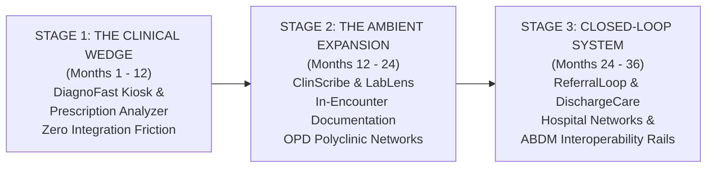

# 📊 Curai: Healthcare Market Analysis & Strategic Intelligence Report

**A Comprehensive Analysis of Outpatient Care Dynamics, Clinical Workflow Fragmentation, Digital Health Economics, and Competitive Positioning in India and Emerging Markets.**

*Date: November 2026 · Target Audience: Healthcare Operators, Venture Investors, Clinical Directors, Policy Makers*

---

## Table of Contents
1. [Executive Summary](#1-executive-summary)
2. [The Outpatient Healthcare Crisis in India](#2-the-outpatient-healthcare-crisis-in-india)
3. [Market Sizing: TAM, SAM & SOM](#3-market-sizing-tam-sam--som)
4. [Competitive Landscape & Strategic Differentiation](#4-competitive-landscape--strategic-differentiation)
5. [Clinical Workflow Economics & Unit Economics](#5-clinical-workflow-economics--unit-economics)
6. [Sociodemographic & Linguistic Drivers: Why Voice-First Wins](#6-sociodemographic--linguistic-drivers-why-voice-first-wins)
7. [Regulatory, Privacy & Digital Health Policy](#7-regulatory-privacy--digital-health-policy)
8. [Go-To-Market (GTM) Strategy & Scaled Commercial Roadmap](#8-go-to-market-gtm-strategy--scaled-commercial-roadmap)
9. [Conclusion & Strategic Outlook](#9-conclusion--strategic-outlook)

---

## 1. Executive Summary

Healthcare delivery in India and peer developing economies faces an unprecedented structural paradox: **rapidly expanding digital public infrastructure alongside acute clinical bandwidth starvation**. 

While the Ayushman Bharat Digital Mission (ABDM) has successfully generated over **93.9 crore Ayushman Bharat Health Accounts (ABHA)**, physical clinical delivery remains trapped in severe operational bottlenecks. The average primary care outpatient consultation in India lasts **scarcely two minutes**, with one government doctor serving over **11,000 citizens** and community health centres experiencing an **80% deficit of medical specialists**.

In this ultra-compressed clinical encounter, clinicians spend up to 75% of their available time performing repetitive oral history elicitations, deciphering paper prescriptions, and manually writing unstructured notes. Downstream, over **87% of patients leave consultations without adequately understanding their medication instructions**, while more than **30% of specialist referrals are lost to follow-up**.

**Curai** addresses this structural crisis through a vertically integrated, visit-aligned clinical workflow platform. By deploying voice-first waiting-room intake (**DiagnoFast**), ambient documentation (**ClinScribe**), dual-engine diagnostic digitization (**LabLens**), patient prescription comprehension (**Prescription Analyzer**), closed-loop referral tracking (**ReferralLoop**), and post-hospitalization task coordination (**DischargeCare**) onto **One Shared Longitudinal Record**, Curai restores up to **90 seconds of high-value clinical time per consultation** while driving medication adherence and care continuity.

---

## 2. The Outpatient Healthcare Crisis in India

```
┌────────────────────────────────────────────────────────────────────────────────────────┐
│                                 THE CRISIS BY THE NUMBERS                              │
├──────────────────────────┬──────────────────────────┬──────────────────────────────────┤
│        2 MINUTES         │        1 : 11,082        │              79.9%               │
│ Average primary-care     │ Government allopathic    │ Rural specialist doctor          │
│ consultation length      │ doctor-to-citizen ratio  │ shortfall in CHCs                │
│ (BMJ Open, 2017)         │ (National Health Profile)│ (Health Dynamics of India)       │
├──────────────────────────┼──────────────────────────┼──────────────────────────────────┤
│       ~4 BILLION         │          12.4%           │          93.95 CRORE             │
│ Annual outpatient doctor │ Outpatients who properly │ Citizens registered on ABHA      │
│ consultations in India   │ understand their Rx      │ digital health rails             │
│ (Praxis Global Alliance) │ (KEM Hospital Mumbai)    │ (Ministry of Health, 2026)       │
└──────────────────────────┴──────────────────────────┴──────────────────────────────────┘
```

### 2.1 The Two-Minute Consultation Bottleneck
According to the landmark international systematic review published in *BMJ Open* (Irving et al., analysing 28.5 million consultations across 67 nations), primary care consultations in India average **scarcely two minutes**. 
- In high-volume government hospitals and private polyclinics, an individual physician regularly examines **60 to 120 patients during a single 4-hour morning OPD shift**.
- Over **76% of diagnostic accuracy depends entirely on clinical history taking** (Peterson et al., *West J Med*). When a consultation lasts 120 seconds, history taking is hurried, incomplete, and prone to diagnostic blind spots.

### 2.2 Physician Supply Constraints & Severe Rural Imbalance
- **Severe Allopathic Deficit**: While the World Health Organization (WHO) establishes a benchmark of at least **1 doctor per 1,000 people**, India’s public healthcare system operates at approximately **1 government allopathic doctor per 11,082 citizens** (National Health Profile).
- **Rural Specialist Vacuum**: According to the Ministry of Health's *Health Dynamics of India 2022–23* report, rural Community Health Centres (CHCs) suffer from a **79.9% shortfall of required medical specialists** (surgeons, obstetricians, gynaecologists, physicians, and paediatricians). As a consequence, primary care clinicians are overwhelmed by cases requiring specialist triage.

### 2.3 The Fragmented Outpatient Experience
The Indian outpatient journey is plagued by physical record fragmentation:
1. **Paper Prescriptions**: Written in hurried clinical shorthand (`1-0-1`, `TDS`, `AC`, `HS`). In a dedicated observational study at KEM Hospital in Mumbai, **only 12.4% of outpatients exhibited adequate knowledge of their prescribed medications**.
2. **Scanned Diagnostic Reports**: Patients carry physical paper slips or smartphone photos of blood tests and radiological scans. Clinicians have no longitudinal trend visibility to evaluate whether biomarkers (e.g., HbA1c, Serum Creatinine) are improving or worsening over time.
3. **The "Silent Referral Drop"**: Patients instructed to seek tertiary specialist consultations receive handwritten slips that are frequently lost, with zero follow-up or confirmation mechanism back to the primary clinic.

---

## 3. Market Sizing: TAM, SAM & SOM

The digital health ecosystem in India is transitioning from basic consumer teleconsultation apps to **deep clinical workflow automation and provider enablement platforms**.

```
┌────────────────────────────────────────────────────────────────────────┐
│ TOTAL ADDRESSABLE MARKET (TAM): $23.3B by 2030                         │
│ India Digital Health Market (MarketsandMarkets, ~25.4% CAGR)           │
│                                                                        │
│   ┌────────────────────────────────────────────────────────────────┐   │
│   │ SERVICEABLE ADDRESSABLE MARKET (SAM): $3.85B                   │   │
│   │ India Outpatient EMR, Scribing & Workflow Software Market      │   │
│   │ (~4 Billion Outpatient Encounters Annually)                    │   │
│   │                                                                │   │
│   │   ┌────────────────────────────────────────────────────────┐   │   │
│   │   │ SERVICEABLE OBTAINABLE MARKET (SOM): $280M             │   │   │
│   │   │ High-Volume Private Polyclinics, Urban Nursing Homes   │   │   │
│   │   │ and Tier-1/2 Outpatient Hospital Networks (5-Year)     │   │   │
│   │   └────────────────────────────────────────────────────────┘   │   │
│   └────────────────────────────────────────────────────────────────┘   │
└────────────────────────────────────────────────────────────────────────┘
```

### 3.1 Total Addressable Market (TAM)
- **Macro Market Growth**: According to research from *MarketsandMarkets*, India’s digital health market is projected to expand from **$7.6 Billion to $23.3 Billion by 2030**, exhibiting a sustained compound annual growth rate (**CAGR**) of over **25.4%**.
- **Macro Consultation Volume**: India records approximately **4.0 to 4.2 billion doctor consultations per year** (Praxis Global Alliance), representing one of the largest outpatient volumes on the planet.

### 3.2 Serviceable Addressable Market (SAM)
Focusing specifically on clinical workflow automation, AI documentation, diagnostic ingestion, and care continuity for private clinics, nursing homes, and hospital OPDs:
- **Provider Universe**: Approximately 1.3 million registered allopathic physicians, ~70,000 private clinics/polyclinics, and ~43,000 private hospitals and nursing homes in India.
- **Estimated Annual Outpatient Workflow Opportunity**: At an average blended workflow value of ₹75 to ₹100 ($0.90 to $1.20) per encounter for integrated intake, ambient scribing, prescription decoding, and referral loop management:
  $$\text{SAM} = 4{,}000{,}000{,}000 \text{ encounters} \times \$0.95 = \mathbf{\$3.80\text{ Billion}}$$

### 3.3 Serviceable Obtainable Market (SOM)
Our targeted initial 5-year capture strategy focuses on:
- 15,000 mid-to-large private clinics and polyclinics in Tier 1 and Tier 2 metro hubs (Delhi NCR, Mumbai MMR, Bengaluru, Hyderabad, Chennai, Pune).
- 2,500 secondary care private nursing homes and outpatient departments.
- Target Annual Recurring Revenue (ARR) benchmark: **$280 Million**.

---

## 4. Competitive Landscape & Strategic Differentiation

The global health-tech landscape has witnessed massive capital inflows into AI scribing (e.g., Abridge valued at $5.3B, Suki AI, Nabla). However, **Western AI healthcare tools fundamentally fail when deployed in Indian and emerging market clinical environments**.

### 4.1 Comparative Feature Matrix

| Strategic Vector | **Curai** | **Eka Care** | **Nabla / Abridge** | **Practo / Legacy EHR** |
|---|:---:|:---:|:---:|:---:|
| **Target Encounter Velocity** | **1 to 3 minute OPD consultations** | 5 to 10 min general visits | 15 to 25 min US/EU appointments | Administrative billing focus |
| **Pre-Visit Voice Intake** | **Yes (DiagnoFast Kiosk & Tokens)** | No (Manual check-in) | No | No (Static appointment forms) |
| **Multilingual Voice Intake** | **Yes (Hindi, English, Neural TTS)** | Partial (Doctor notes) | English / European languages only | English text only |
| **Emergency Triage Engine** | **Deterministic 2-layer Red Flags** | None | None (Pure documentation) | None |
| **Ambient Encounter Scribing** | **Yes (ClinScribe with Verifier 2.0)** | Yes (Doctor speech) | Yes (Ambient audio) | No (Manual typing required) |
| **Prescription Photo OCR & Guidance** | **Yes (Shorthand + 250k Drug DB)** | Basic scanner | No | No |
| **Patient Confirmation Gate** | **Mandatory Tick-Gate (Zero guessing)** | None | N/A | N/A |
| **Diagnostic PDF / Photo Parser** | **Dual Engine (Local + Vision OCR)** | Manual upload | No | Document repository only |
| **Closed-Loop Specialist Referrals** | **Yes (ReferralLoop State Machine)** | No | No | Basic directory listing |
| **Post-Discharge Transition Checklists**| **Yes (DischargeCare Task Gates)** | No | No | Static printouts |
| **Single Shared Patient Record** | **Yes (All 6 tools share 1 DB)** | Partial | Single-purpose utility | Siloed database |

### 4.2 Why Western Ambient Scribes Fail in India
1. **Designed for US Billing Complexity, Not Speed**: US scribes (Abridge, Nuance DAX) are engineered to generate extensive ICD-10 and CPT coding narratives for insurance reimbursement during 20-minute encounters. In India, cash-paying patients and rapid OPDs require **concise, high-density 1-page clinical summaries produced in seconds**.
2. **Linguistic & Accent Disconnect**: US models struggle with Indian English clinical phrasing, code-switched Hindi-English ("Hinglish"), and regional medication nomenclature.
3. **Absence of an Indian Drug Registry**: US tools do not recognize India-specific brand names (e.g., *Augmentin 625*, *Pan-D*, *Azee 500*, *Glycomet-GP*) or Latin-Hindi dosage shorthand (`1-0-1`, `OD`, `TDS`).

### 4.3 Curai’s Unfair Advantage: The Visit-Aligned Flywheel
Unlike single-purpose tools (an ambient scribe alone, or an OCR scanner alone), Curai captures the patient **before** they enter the room, assists the doctor **during** the encounter, and protects the patient **after** they leave. Every step feeds structured clinical context into the same longitudinal chart.

---

## 5. Clinical Workflow Economics & Unit Economics

### 5.1 Time Recovery & Clinic Revenue Expansion
In a typical Indian outpatient clinic, time is the ultimate scarce resource:

```
┌────────────────────────────────────────────────────────────────────────┐
│          TIME ALLOCATION PER 2.5-MINUTE (150-SECOND) VISIT             │
├──────────────────────────────────────┬─────────────────────────────────┤
│ WITHOUT CURAI                        │ WITH CURAI                      │
├──────────────────────────────────────┼─────────────────────────────────┤
│ Repetitive oral intake: 75 seconds   │ Pre-intake reviewed: 15 seconds │
│ Diagnostic paper decoding: 30 seconds│ LabLens trend graph: 10 seconds │
│ Physical examination: 30 seconds     │ Physical examination: 45 seconds│
│ Manual prescription writing: 15 secs │ Ambient ClinScribe: 15 seconds  │
│ Patient instruction guidance: hurried│ Prescription Analyzer: offloaded│
├──────────────────────────────────────┼─────────────────────────────────┤
│ CLINICIAN TIME RECOVERED PER VISIT:  │ 65 TO 90 SECONDS                │
└──────────────────────────────────────┴─────────────────────────────────┘
```

* **Capacity Expansion**: Recovering 75 seconds per patient allows a busy clinic to comfortably see **an additional 15 to 25 patients per 4-hour OPD session** without clinician burnout.
* **Clinic Revenue Increase**: At an average consultation fee of ₹500 ($6.00), seeing 20 additional patients daily generates:
  $$\text{Incremental Daily Revenue} = 20 \times ₹500 = \mathbf{₹10{,}000\text{/day}} \quad (\approx \mathbf{₹2{,}50{,}000\text{/month}})$$

### 5.2 Unit Economics & Cloud Inference Margins
Curai's architectural design prioritizes deterministic, local computation over costly LLM invocations wherever possible:

| Tool & Workflow Step | Compute Engine | Average Tokens / Call | Cost per Encounter |
|---|---|:---:|:---:|
| **DiagnoFast Intake Turn** | Edge-TTS + Groq / Gemini | ~450 tokens | ₹0.18 ($0.002) |
| **DiagnoFast Requisition Summary** | Gemini Flash / Groq Llama 3 | ~1,200 tokens | ₹0.45 ($0.005) |
| **ClinScribe Ambient Drafting** | Groq Whisper + Llama 3 | 25s audio chunks + ~1,500 tokens | ₹0.90 ($0.011) |
| **LabLens Text PDF Extraction** | Local Server (`pdfplumber`) | 0 tokens (Deterministic) | **₹0.00 (Zero)** |
| **LabLens Scanned Photo OCR** | Gemini 1.5/2.0 Vision | 1 image + ~800 tokens | ₹0.40 ($0.005) |
| **Prescription Shorthand Decoding**| Local Regex Engine (`shorthand.py`)| 0 tokens (Deterministic) | **₹0.00 (Zero)** |
| **Prescription 250k Drug Match** | Local `rapidfuzz` index | 0 tokens (Deterministic) | **₹0.00 (Zero)** |
| **Prescription Plain Explanation** | Gemini / Groq multilingual | ~800 tokens | ₹0.35 ($0.004) |
| **TOTAL BLENDED ENCOUNTER COST** | — | — | **₹2.28 ($\approx \$0.027$)** |

> **Gross Margin Profile**: At a targeted SaaS pricing tier of ₹15 to ₹25 ($0.18 to $0.30) per complete digitized patient encounter, Curai operates at an outstanding **software gross margin exceeding 82% to 88%**.

---

## 6. Sociodemographic & Linguistic Drivers: Why Voice-First Wins

### 6.1 The Rural & Semi-Urban Literacy Landscape
According to the Periodic Labour Force Survey (PLFS 2023–24):
- Rural literacy stands at **77.5%**, meaning **nearly 1 in 4 rural citizens cannot read or write**. Among rural adult women, historical Census figures reveal illiteracy rates approaching 45%.
- Over **75% of Indian outpatients cannot read or comprehend English medical instructions**.
- **The Voice Imperative**: Text-based patient portals, mobile chat apps, and typing forms alienate the very populations who suffer the greatest disease burdens. DiagnoFast's spoken neural audio in Hindi (`Swara`) and Indian English (`Neerja`) completely removes the literacy barrier.

### 6.2 Legal Mandates on Prescription Legibility
The issue of illegible handwriting has crossed into the Indian judiciary:
- In August 2025, the **High Court of Punjab and Haryana issued a landmark ruling establishing that a legible medical prescription is an integral component of the Fundamental Right to Health** under Article 21 of the Constitution of India.
- The National Medical Commission (NMC) subsequently mandated that medical practitioners must write in clear capital letters or adopt digital prescribing platforms.
- Prescription Analyzer provides clinics with an instant safety net, converting illegible handwriting into verified digital guidance without requiring doctors to abandon their existing paper pads.

---

## 7. Regulatory, Privacy & Digital Health Policy

Healthcare platforms in India operate under rapidly maturing regulatory frameworks that require strict architectural discipline:

### 7.1 CDSCO Software as a Medical Device (SaMD) Guidelines
In July 2026, the Central Drugs Standard Control Organisation (CDSCO) expanded regulatory oversight over clinical AI software:
- **Decision Support Boundaries**: Software that independently diagnoses, determines triage priority, or calculates medication dosages is classified as a regulated medical device requiring clinical trials and CDSCO licensing.
- **Curai's Compliance Architecture**: Curai strictly bounds its AI to **non-diagnostic administrative drafting, structured data extraction, and clinical summarization**. Every inference is flagged as an unapproved candidate draft until validated by a licensed physician, keeping Curai firmly in the safe clinical-assist category.

### 7.2 Digital Personal Data Protection (DPDP) Act 2023
- **Explicit Purpose-Bound Consent**: Personal and medical data processing requires unambiguous consent. Curai manages purpose-specific consent tokens (`ai_scribe`, `ai_processing`, `transcript_retention`).
- **Immediate Revocation**: Revoking consent immediately terminates downstream data sharing across all specialist referral routes.
- **Data Minimization & Ephemeral Storage**: ClinScribe automatically purges raw audio buffers and consultation transcripts the instant a clinician digitally signs the note.
- **Encrypted Document Vault**: Patient uploads and clinical records are encrypted at rest using AES-256-GCM envelope encryption.

### 7.3 ABDM & FHIR R4 Interoperability
- With **93.95 crore ABHA accounts already created**, India is building the world's largest interoperable health exchange.
- Curai is designed with native **FHIR R4 Composition and DiagnosticReport** schemas (`GET /api/patients/{id}/fhir`), enabling seamless integration into ABDM Health Information Providers (HIP) and Health Information Users (HIU).

---

## 8. Go-To-Market (GTM) Strategy & Scaled Commercial Roadmap



### Phase 1: The Frictionless Clinical Wedge (Months 1 to 12)
- **Target**: Individual physician private practices, high-volume OPD clinics, and standalone diagnostic centres.
- **Value Proposition**: "Deploy a waiting-room intake kiosk on a tablet in 5 minutes with zero IT overhaul."
- **Wedge Products**:
  1. *DiagnoFast Kiosk*: Generates 1-page paper-ready requisitions before patients enter the cabin.
  2. *Prescription Analyzer QR Code*: Given to patients at pharmacy billing to explain their medications.
- **Acquisition Channel**: Direct-to-physician digital acquisition, medical association symposiums (IMA, FOGSI, API), and pharmaceutical distribution partnerships.

### Phase 2: Polyclinic & Ambient Expansion (Months 12 to 24)
- **Target**: Multi-specialty outpatient clinics, day-care surgical centres, and regional diagnostic chains.
- **Value Proposition**: "Ambient clinical documentation (ClinScribe) and unified lab report longitudinal tracking (LabLens) across all consulting rooms."
- **Commercial Model**: Tiered per-doctor monthly SaaS subscription (₹2,500 to ₹4,500 / month / doctor seat) with inclusive token quota.

### Phase 3: Enterprise Hospital Networks & Care Continuity (Months 24 to 36)
- **Target**: 50 to 250-bed secondary care private hospital networks and municipal healthcare boards.
- **Value Proposition**: "Closed-loop specialist referral tracking (ReferralLoop) and post-hospitalization discharge compliance (DischargeCare) to eliminate readmissions and patient leakage."
- **Enterprise Integrations**: Bi-directional integration into hospital information systems (HIS), enterprise MongoDB Atlas event projections, and certified ABDM M1/M2/M3 gateway connectors.

---

## 9. Conclusion & Strategic Outlook

Healthcare delivery cannot scale by simply building more hospitals or asking overburdened clinicians to work faster. In high-volume outpatient settings where consultations are compressed into minutes, **clinical technology must eliminate friction rather than impose new data-entry demands**.

Curai represents a paradigm shift in healthcare workflow intelligence:
1. **It respects clinical velocity**: Built specifically for the 2-minute consultation, preparing history *before* the encounter starts.
2. **It bridges the health literacy divide**: Multilingual, neural-voiced, and plain-language guidance that empowers patients regardless of reading ability.
3. **It maintains an uncompromising safety posture**: Deterministic emergency safety nets, patient confirmation gates, and absolute human clinical governance.

By unifying patient records, ambient documentation, diagnostic intelligence, and care transitions into **One Connected Platform**, Curai establishes the foundational operating system for efficient, high-quality, and scalable healthcare delivery across India and emerging economies.

---

<div align="center">

**Curai** · *Connected, Organised and Intelligent Care.*<br />
<sub>Confidential Business & Market Intelligence · Built for Global Health Innovation</sub>

</div>
