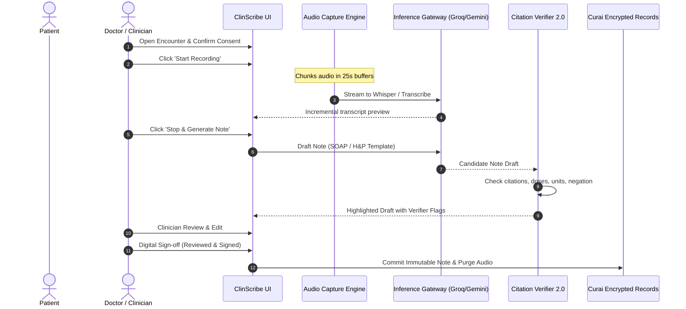

# 📝 ClinScribe: Ambient Clinical Documentation & Scribing

## 1. Executive Summary
**ClinScribe** is an ambient clinical documentation assistant designed to eliminate administrative burden during outpatient consultations. With explicit patient consent, ClinScribe records the doctor-patient dialogue, transcribes the conversation, and synthesizes structured encounter documentation (SOAP or History & Physical format).

ClinScribe operates on an uncompromising safety principle: **every generated clinical statement must be explicitly substantiated by dialogue citations, and final notes require authenticated physician sign-off.**

---

## 2. Encounter Workflow

---

## 3. Key Capabilities

### 3.1 Streaming Audio & Chunk Resilience
- Consultations are streamed in 25-second audio buffers directly to Groq Whisper for near-instantaneous transcription.
- **Lost Chunk Accounting**: If an unstable network drops an audio buffer, ClinScribe records the lost chunk on the session record (`chunks_lost`) and surfaces an "N chunks lost" warning badge to alert the clinician to verify missing details.
- **Manual Missed-Line Entry**: Doctors or scribes can manually inject missed statements into the stopped session (`missed_line: true`) before triggering note generation.

### 3.2 Dynamic Clinical Templates
- **Standard SOAP Note**:
  - *Subjective*: Chief complaint, duration, HPI narrative, patient-reported symptoms.
  - *Objective*: Clinician physical examination findings, vitals, on-hand diagnostic values.
  - *Assessment*: Clinical impression, differential considerations, diagnostic status.
  - *Plan*: Prescriptions, diagnostic investigations ordered, lifestyle guidance, follow-up timeline.
- **History & Physical (H&P)**: Comprehensive inpatient admission note format.

### 3.3 Citation Verifier 2.0 (Anti-Hallucination Engine)
ClinScribe incorporates a dedicated citation verification layer that inspects candidate sentences before the clinician sees the draft:
- **Numerical & Dosage Verification**: Every dosage number ("500 mg", "10 units") is cross-checked strictly against the cited transcript lines. Numbers mentioned in unrelated sentences are rejected.
- **Negation & Side Inversion Safeguard**: Verifies that negative statements ("no swelling", "denies nausea") are not rendered as positive findings and flags left/right anatomical discrepancies.
- **Prescription Frequency Validation**: Ensures frequency directions (e.g., "twice daily after food") precisely mirror the recorded discussion.

### 3.4 Physician Review & Digital Sign-Off
- A draft note remains in `draft` status and is completely hidden from patients and external FHIR feeds.
- The attending doctor must review any verifier flags, make adjustments, and apply a formal sign-off (`POST notes/{id}/approve`).
- **Complete Version Auditing**: Every iteration—from initial AI candidate through clinician edits to final signed note—is preserved in `clinical_note_versions` with model, prompt, and verifier metadata.

### 3.5 Privacy-First Ephemeral Audio Lifecycle
Consultation audio is treated as strictly temporary processing data. The moment a physician digitally signs a clinical note, all raw audio chunks and verbatim transcripts are permanently purged from server memory and disk unless explicit, separate consent for transcript retention was recorded.

---

## 4. Technical Specification & API Endpoints

- **Backend Module**: `backend/clinscribe/`
  - `routes.py`: Encapsulates all ambient session and note management routes.
  - `verifier.py`: Multi-stage transcript citation verification logic.
  - `schema.sql`: Table definitions for `scribe_sessions`, `transcript_segments`, `clinical_notes`, and `clinical_note_versions`.
- **Primary Endpoints**:
  - `POST /api/addons/clinscribe/encounters/{id}/sessions`: Creates a new recording session.
  - `POST /api/addons/clinscribe/sessions/{id}/state`: Manages session lifecycle (`paused`, `recording`, `stopped`).
  - `POST /api/addons/clinscribe/sessions/{id}/transcribe`: Ingests and processes audio chunk buffers.
  - `POST /api/addons/clinscribe/sessions/{id}/draft-note`: Triggers structured SOAP / H&P drafting.
  - `PATCH /api/addons/clinscribe/notes/{id}`: Records clinician edits during review.
  - `POST /api/addons/clinscribe/notes/{id}/approve`: Finalizes note with digital clinician signature.
  - `GET /api/addons/clinscribe/notes/{id}/fhir`: Exports finalized note as a FHIR R4 DocumentReference / Composition.
