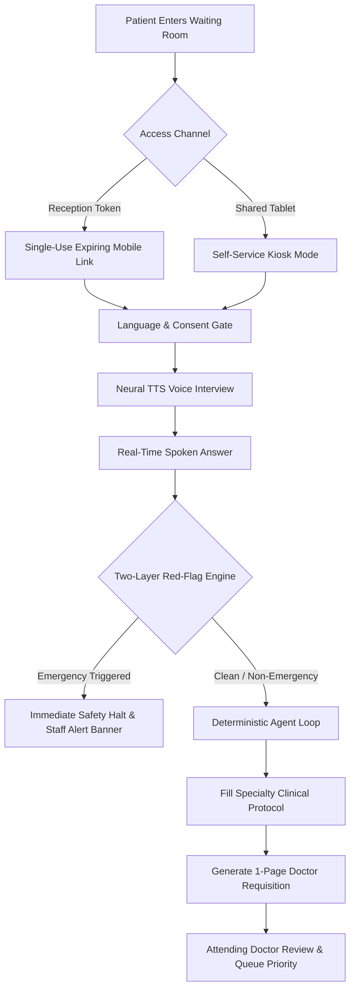

# 🩺 DiagnoFast: Voice-First Conversational Patient Intake

## 1. Executive Summary
**DiagnoFast** is a multilingual, voice-first pre-consultation intake agent designed for hospital waiting rooms and clinic reception desks. By capturing structured patient history while the patient is waiting, DiagnoFast prepares a concise, one-page clinical requisition before the patient enters the examination room.

In settings where primary care consultations average under two minutes, DiagnoFast saves up to 90 seconds of repetitive history-taking per visit while ensuring critical emergency symptoms are immediately intercepted.

---

## 2. Key Capabilities & Workflow



### 2.1 Multilingual Neural Voice Experience
- **Spoken Question Synthesis**: Integrates Microsoft Edge neural speech engines (`Neerja` for Indian English and `Swara` for Hindi), providing natural, empathetic conversational pacing.
- **Fail-Safe Audio Pipeline**: Automatically falls back to Groq WAV synthesis or local client-side Web Speech synthesis if neural cloud connections experience latency exceeding 8 seconds.
- **Speech-to-Text with Editable Preview**: Patients answer orally; live speech recognition renders on-screen in real time. Patients can review, edit, or append to their answers before final submission.

### 2.2 Access Channels: Kiosk & One-Time Tokens
- **Reception-Generated One-Time Links**: Secure 24-hour expiring tokens sent via SMS or QR code. The session automatically closes 2 hours after initiation to prevent stale clinical state.
- **Self-Service Kiosk (`intake.html`)**: When `DIAGNOFAST_KIOSK_DOCTOR_ID` is set to a verified clinician ID, shared hospital tablets operate in zero-login kiosk mode. Public callers cannot alter clinical assignments or access unauthorized charts.

### 2.3 Six Standardized Specialty Protocols
DiagnoFast uses structured clinical forms covering core outpatient departments:
1. **General Medicine**: Comprehensive HPI, fever duration, constitutional symptoms, chronic illnesses.
2. **Dermatology**: Rash morphology, onset, pruritus, distribution, topical exposures.
3. **Cardiology**: Exertional angina, orthopnoea, palpitation frequency, peripheral oedema.
4. **Orthopaedics**: Joint/bone pain distribution, weight-bearing ability, trauma history, mechanical lock.
5. **ENT**: Otalgia, rhinorrhoea, dysphagia, vertiginous episodes, auditory changes.
6. **Paediatrics**: Immunization currency, developmental milestones, fluid intake, parental observations.

---

## 3. Clinical Safety & Emergency Triage Engine

Emergency presentation detection must never rely solely on generative AI. DiagnoFast implements a **deterministic two-layer safety architecture**:

```
                              PATIENT ANSWER
                                    │
                                    ▼
       ┌────────────────────────────────────────────────────────┐
       │   LAYER 1: Code-Based Regular Expression Screen        │
       │   - English, Hindi, and Hinglish vocabulary            │
       │   - Regex negation filters ("no chest pain" ignored)   │
       │   - Zero LLM dependency; runs even if AI is offline   │
       └────────────────────────────┬───────────────────────────┘
                                    │
                    Clean / No Emergency Detected
                                    │
                                    ▼
       ┌────────────────────────────────────────────────────────┐
       │   LAYER 2: Secondary LLM Contextual Classifier         │
       │   - Disambiguates complex or subtle presentations      │
       │   - Filters historical accounts ("uncle had a stroke") │
       └────────────────────────────┬───────────────────────────┘
                                    │
              ┌─────────────────────┴─────────────────────┐
              ▼                                           ▼
      [CRITICAL EMERGENCY]                        [NON-EMERGENCY]
  1. Interview ends immediately               Continue conversational loop
  2. Urgent UI instruction to desk            Max 12 clinical questions
  3. Real-time alert to staff queue           Doctor receives requisition
```

### Real-Time Clinic Alert Broadcast
When an emergency is triggered, DiagnoFast initiates an immediate triage response:
- The patient interface freezes on an emergency guidance screen instructing the patient to report directly to clinic staff.
- A background event fires, surfacing across all active clinical screens via `GET /api/diagnofast/alerts` as a high-visibility, persistent alert banner.

---

## 4. Physician Deliverable: The One-Page Requisition

When the patient completes intake, the attending doctor receives an organized clinical dossier:
- **Demographics & Intake Barcode**: Unique intake identifier and timestamp.
- **Chief Complaint & Duration**: Extracted primary reason for encounter.
- **Structured Review of Systems (ROS)**: Clearly highlights positive findings and confirms explicit negatives.
- **Allergy & Medication Reconciliation**: Mandatory closing inquiries ensuring chronic medications and drug allergies are never bypassed.
- **Expandable Audit Trail**: Doctors can click any extracted statement to view verbatim transcripts or replay original voice audio.
- **Printable A4 Requisition**: Formatted for standard clinical paper charts with an unencumbered blank physician workspace for physical exam findings.

---

## 5. Technical Specification & API Endpoints

- **Backend Module**: `backend/diagnofast/`
  - `agent.py`: Turn management, question selection, field extraction.
  - `red_flags.py`: Regex and keyword emergency rules.
  - `validate.py`: Citation and range validation.
  - `routes.py`: REST endpoints.
- **Primary Endpoints**:
  - `POST /api/diagnofast/start`: Initializes session, verifies token, records consent.
  - `POST /api/diagnofast/patient/{token}/advance`: Processes patient response, executes safety screen, returns next question.
  - `POST /api/diagnofast/patient/{token}/help`: Allows patient to request reception intervention.
  - `GET /api/diagnofast/intakes/{id}`: Retrieves completed structured clinical requisition.
  - `POST /api/diagnofast/intakes/{id}/review`: Clinician digital review sign-off.
  - `GET /api/diagnofast/alerts`: High-priority polling endpoint for active emergency alerts.
