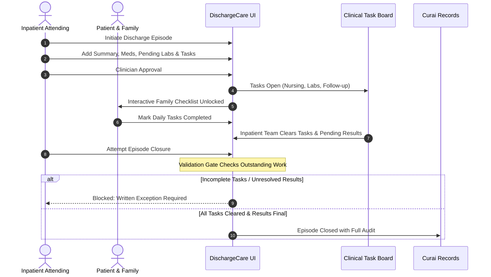

# 🏥 DischargeCare: Post-Hospitalization Transition & Task Coordination

## 1. Executive Summary
**DischargeCare** safeguards patients during the high-risk transition window between hospital discharge and recovery at home. Fragmented hospital handovers are a primary driver of 30-day preventable readmissions and adverse post-surgical complications.

DischargeCare translates complex inpatient discharge orders into bite-sized, daily actionable checklists for patients and family caregivers while providing clinical teams with a tracked board of post-acute clinical responsibilities.

---

## 2. Inpatient Transition Workflow

---

## 3. Key Capabilities

### 3.1 Plain-Language Family Checklists
- Converts dense clinical summaries into an accessible, prioritized daily recovery roadmap for patients and family members:
  - When and how to take newly prescribed post-discharge medications.
  - Specific warning signs requiring immediate emergency room return (e.g., wound discharge, temperature $>101^\circ\text{F}$, calf pain).
  - Activity restrictions, wound dressing protocols, and dietary instructions.

### 3.2 Clinical Care Team Task Board
- Orchestrates multi-disciplinary responsibilities across the care team:
  - Verification of pending outpatient culture or biopsy results.
  - Coordination of post-discharge home health or nursing visits.
  - Scheduling of outpatient stitch/staple removal and specialist follow-up clinics.

### 3.3 Strict Transition Closure Gates
An inpatient discharge episode cannot be quietly archived or closed by accident:
- **Mandatory Completion Checks**: The system enforces that all required clinical tasks must be completed, all pending lab results must be finalized, and all identified discharge barriers must be resolved.
- **Exception Logging**: If an episode must be closed with pending items, the responsible attending physician must explicitly enter a written clinical exception explaining the rationale.

### 3.4 Episode Reopening & Safety Recalls
- If a patient experiences acute complications post-discharge, any authorized clinician on the care team can reopen the episode with documented clinical justification.
- Reopening immediately notifies the primary attending physician and re-activates monitoring tasks on the clinical board.

---

## 4. Technical Specification & API Endpoints

- **Backend Module**: `backend/dischargecare/`
  - `routes.py`: Manages discharge episode workflows, checklists, and barriers.
  - `schema.sql`: Table definitions for `discharge_episodes`, `discharge_instructions`, `discharge_barriers`, and `discharge_pending_results`.
- **Primary Endpoints**:
  - `POST /api/addons/dischargecare/episodes`: Creates a new inpatient discharge episode.
  - `GET /api/addons/dischargecare/board`: Multi-patient clinical coordination board.
  - `POST /api/addons/dischargecare/episodes/{id}/instructions`: Attaches patient recovery instructions.
  - `POST /api/addons/dischargecare/episodes/{id}/approve`: Attending clinician approval activating tasks.
  - `GET /api/addons/dischargecare/episodes/{id}/checklist`: Patient/family interactive checklist view.
  - `POST /api/addons/dischargecare/episodes/{id}/close`: Validates gates and finalizes discharge episode.
