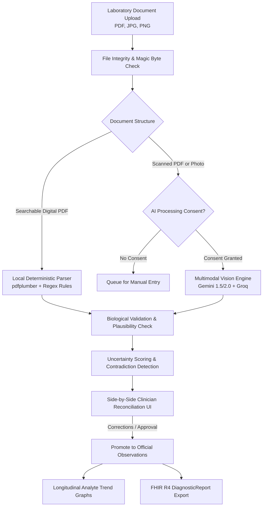

# 🔬 LabLens: Diagnostic Report Digitization & Longitudinal Tracking

## 1. Executive Summary
**LabLens** transforms fragmented, unstructured laboratory reports—including digital PDFs, physical printout photos, and scanned documents—into standardized, reviewable clinical observations.

Rather than treating lab tests as isolated static snapshots, LabLens normalizes analyte names, validates biological reference intervals, and organizes confirmed measurements into longitudinal health trajectories.

---

## 2. Hybrid Dual-Engine Architecture

---

## 3. Key Capabilities

### 3.1 Local Zero-Cost PDF Parser
- When a laboratory issues a true digital PDF, LabLens extracts text directly on Curai's local server using `pdfplumber` and deterministic tabular parsing rules.
- **Privacy & Speed**: Operates with zero network latency, zero per-token API cost, and zero external data egress.

### 3.2 Multimodal Vision OCR for Physical Reports
- For scanned papers and smartphone camera photos, LabLens utilizes high-resolution vision pipelines (Google Gemini first choice, Groq fallback) to extract complex lab report layouts, multi-column tables, and handwritten annotations.
- Handles up to 9 document pages sequentially in 3-image processing batches.

### 3.3 Rigorous Analyte Validation & Plausibility Screening
Every extracted lab row undergoes automatic safety cross-examination against an internal catalogue of ~50 common analytes (`analytes.json`):
- **Contradictory Flag Detection**: Flags instances where a laboratory's printed text says "HIGH" or "LOW", but the reported numerical value actually falls within the stated reference interval.
- **Unit Normalization Guard**: Ensures measurements with incompatible units (e.g., mg/dL vs. mmol/L) are flagged and never erroneously grouped or trended together.
- **Physiological Plausibility Limits**: Catches gross extraction or transcription errors (e.g., typing `112` instead of `11.2` for haemoglobin).
- **Patient Identity Verification**: Compares the name printed on the lab report header against the patient's record, requiring explicit clinical acknowledgment if a discrepancy is detected.

### 3.4 Clinician Reconciliation & Confirm Gate
- Extracted results enter `needs_review` status.
- Clinicians or laboratory staff review results in an interactive split-view interface showing the original document beside extracted rows.
- Only upon explicit confirmation (`POST reports/{id}/confirm`) are values promoted to permanent `observations` linked to the patient's longitudinal record.

### 3.5 Longitudinal Analyte Graphing
- Plots historical trends for chronic biomarkers (HbA1c, Fasting Blood Glucose, Serum Creatinine, eGFR, Lipid sub-fractions, Liver Enzymes).
- Helps physicians evaluate treatment efficacy over months and years rather than relying on single-point results.

---

## 4. Technical Specification & API Endpoints

- **Backend Module**: `backend/lablens/`
  - `parser.py`: Deterministic text extraction, regex tables, qualitative result handlers.
  - `extract.py`: Multimodal vision extraction and background task coordinator.
  - `mappings.py`: Analyte normalization, LOINC mappings, and standard unit checks.
  - `routes.py`: REST API handlers.
- **Primary Endpoints**:
  - `POST /api/addons/lablens/reports`: Ingests and queues laboratory documents.
  - `GET /api/addons/lablens/reports/{id}/extraction`: Fetches extracted rows with uncertainty metadata.
  - `PATCH /api/addons/lablens/results/{id}`: Records corrections to individual analyte values.
  - `POST /api/addons/lablens/reports/{id}/confirm`: Commits reconciled rows to permanent observations.
  - `GET /api/addons/lablens/patients/{id}/trends`: Retrieves historical analyte time-series for graphing.
  - `GET /api/addons/lablens/reports/{id}/fhir`: Emits a standardized FHIR R4 `DiagnosticReport` bundle.
