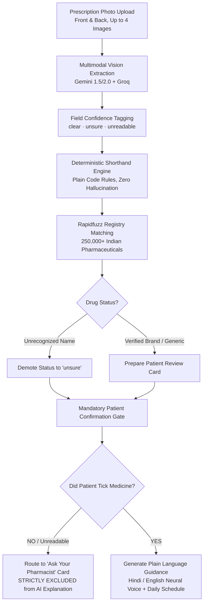

# 💊 Prescription Analyzer: Medication Guidance & Comprehension

## 1. Executive Summary
**Prescription Analyzer** bridges the dangerous comprehension gap between handwritten outpatient prescriptions and patient adherence at home. In many outpatient consultations, patients receive handwritten slips laden with abbreviations like `1-0-1`, `OD`, `BD`, `TDS`, or `SOS`, which are often misunderstood.

By pairing vision models with a deterministic medical shorthand parser and a 250,000+ Indian medicine registry, the Prescription Analyzer decodes prescription photos into clear, patient-friendly guidance in plain Hindi and English.

Crucially, **no medication is ever explained until the patient explicitly reviews and ticks it against their physical slip.**

---

## 2. Architecture & Safety Workflow

---

## 3. Key Capabilities

### 3.1 Multi-Page Multimodal Vision Reader
- Ingests up to 4 high-resolution images per encounter (handling double-sided slips, hospital letterheads, and follow-up dosage adjustments).
- Evaluates image quality, lighting, and angle, returning structured medication candidates tagged by line and item.

### 3.2 Deterministic Medical Shorthand Parser (`shorthand.py`)
Generative LLMs are prone to hallucinating dosage schedules. Curai replaces LLM guessing with a **strict, deterministic shorthand engine**:
- **Dose Frequency Codes**:
  - `OD` / `QD`: Once daily (fixed time)
  - `BD` / `BID`: Twice daily (morning and evening)
  - `TDS` / `TID`: Thrice daily (morning, afternoon, night)
  - `QID`: Four times daily
  - `HS`: At bedtime / hora somni
  - `SOS` / `PRN`: As needed / emergency only (SOS medications are strictly prevented from having rigid calendar schedules)
- **Meal Timing Codes**:
  - `AC`: Ante cibum / Before food (30 minutes prior)
  - `PC`: Post cibum / After food
  - `BBF`: Before breakfast
- **Dose Matrices**: Parses clinical notations like `1-0-1`, `1-0-0`, `0-0-1`, `1/2-0-1/2`, and `x-x-1`.
- **Conflict Prevention**: If the written shorthand conflicts with the dosage text, the engine withholds the time grid rather than making assumptions.

### 3.3 250,000+ Indian Pharmaceutical Registry Cross-Check
- Cross-references candidate drug names against a massive dataset of approved Indian brand names and generic compositions using `rapidfuzz`.
- If an extracted name does not match an entry in the verified database, it is automatically demoted from `clear` to `unsure`, triggering clinical re-verification.

### 3.4 Mandatory Patient Tick-Gate (The Safety Net)
- Patients are presented with an interactive checklist showing each candidate medicine, strength, and decoded instructions.
- The patient must compare each entry with their physical paper slip and tick only the entries that match.
- **Quarantine Principle**: Any unticked, unreadable, or conflicting item is immediately routed to a designated **"Ask Your Pharmacist"** checklist. It is completely blocked from AI explanation.

### 3.5 Patient-Friendly Multilingual Explanation
For confirmed medications only:
- **Plain Hindi & Indian English Explanations**: Translates technical medical terms into clear conversational language.
- **Daily Dosing Timelines**: Visual morning, afternoon, evening, and bedtime schedule matrices with meal proximity reminders.
- **Precautions & Dietary Guidance**: Advises on basic precautions (e.g., "avoid dairy within 2 hours of this antibiotic", "take with a full glass of water").
- **Zero Dose Changes / Zero Substitutions**: Curai's prompt architecture strictly forbids altering dosages, recommending brand substitutes, or advising drug discontinuation.

---

## 4. Technical Specification & API Endpoints

- **Backend Module**: `backend/prescription/`
  - `analyzer.py`: Vision orchestration, candidate extraction, and validation pipeline.
  - `shorthand.py`: Deterministic Latin and numerical shorthand rule engine.
  - `medicines.py`: RapidFuzz fuzzy search over 250,000 Indian drug listings.
  - `routes.py`: API route handlers.
- **Primary Endpoints**:
  - `POST /api/prescription/read`: Uploads up to 4 prescription photos and extracts candidate rows.
  - `POST /api/prescription/confirm`: Ingests patient tick confirmations and records verified items.
  - `POST /api/prescription/explain`: Generates plain-language audio and visual schedules for confirmed drugs only.
  - `POST /api/prescription/read-twice`: Experimental double-blind reading mode (runs two distinct models and flags disagreements).
