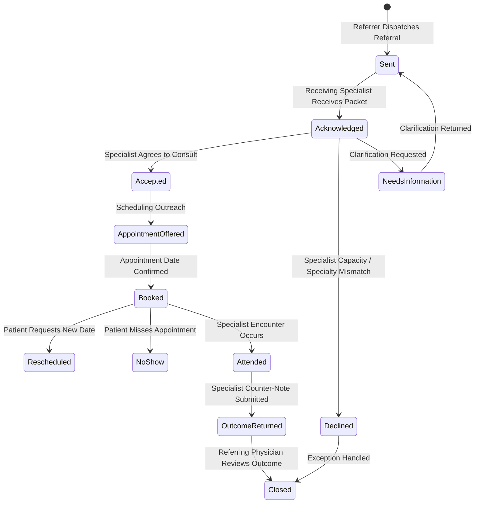

# 🔄 ReferralLoop: Closed-Loop Specialist Coordination

## 1. Executive Summary
**ReferralLoop** closes the dangerous coordination gaps between primary care physicians and medical specialists. In typical outpatient environments, over 30% of specialist referrals are lost in transit—patients fail to schedule visits, specialists receive zero medical history, and referring doctors never receive counter-consultation notes.

ReferralLoop treats a specialist referral as a tracked, stateful lifecycle rather than an unmonitored piece of paper, ensuring that care teams are proactively alerted when a referral stalls.

---

## 2. Full-Lifecycle Referral State Machine

---

## 3. Key Capabilities

### 3.1 Seamless Context Packaging
When a primary care physician initiates a referral:
- DiagnoFast pre-intake summaries, ClinScribe signed encounter notes, and LabLens diagnostic trends are automatically bundled into a single structured clinical referral packet.
- The specialist receives a comprehensive clinical picture without requiring the patient to re-explain their entire history.

### 3.2 Elimination of "Silent Drops"
- **Proactive Overdue Sweeps (`chase_overdue`)**: A scheduled system background worker monitors all active referrals. If a referral remains in `sent`, `acknowledged`, or `accepted` past its reply-by threshold, it automatically creates a high-priority action task for the referring clinic.
- **Escalation Workflows**: When a patient misses an appointment (`no_show`), staff coordinators are automatically prompted to initiate outreach.

### 3.3 Managed Replacement Workflow
If a specialist declines a referral or redirects to another facility:
- The system prevents dead ends through a structured replacement workflow.
- A replacement referral is dispatched (`replaces_referral_id`), transferring clinical history and priority while maintaining an audit trail linking the old and new attempts.

### 3.4 Bi-Directional Consultation Closure
- A referral cannot simply be marked "complete" without clinical evidence.
- Moving to `closed` strictly requires the receiving specialist to submit a consultation note (`outcome_returned`), which must be acknowledged and signed off by the referring clinician.

---

## 4. Technical Specification & API Endpoints

- **Backend Module**: `backend/referralloop/`
  - `routes.py`: Referral lifecycle management, state transition validation, and filters.
  - `schema.sql`: Table definitions for `referrals`, `referral_appointments`, `referral_history`, and `referral_outcomes`.
- **Primary Endpoints**:
  - `POST /api/addons/referralloop/referrals`: Creates and dispatches a new specialist referral.
  - `GET /api/addons/referralloop/referrals/{id}`: Retrieves complete referral dossier and history.
  - `POST /api/addons/referralloop/referrals/{id}/state`: Manages state machine transitions.
  - `POST /api/addons/referralloop/referrals/{id}/appointments`: Schedules or updates specialist appointment slots.
  - `POST /api/addons/referralloop/referrals/{id}/outcome`: Ingests specialist consultation summary.
  - `POST /api/addons/referralloop/referrals/{id}/close`: Referring doctor sign-off closing the loop.
